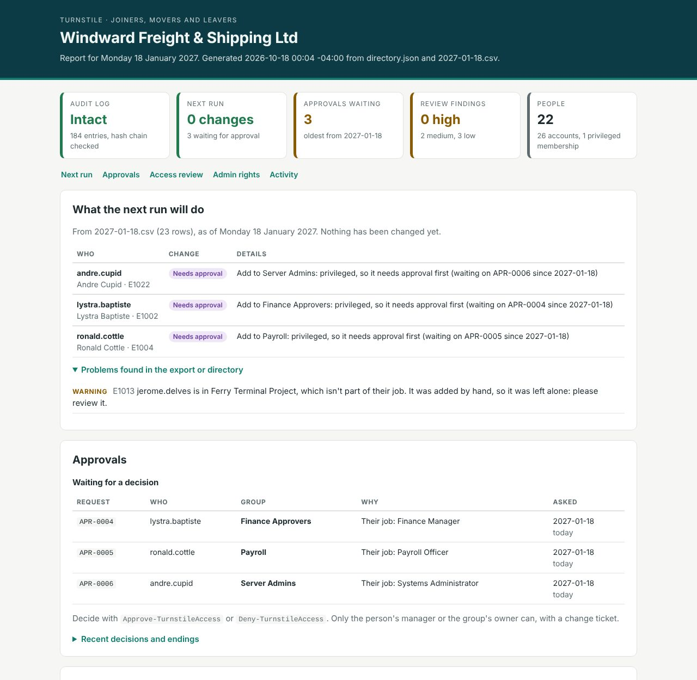
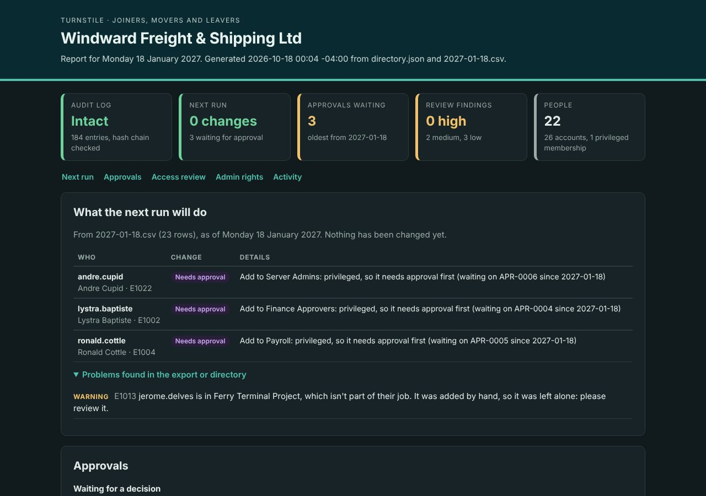
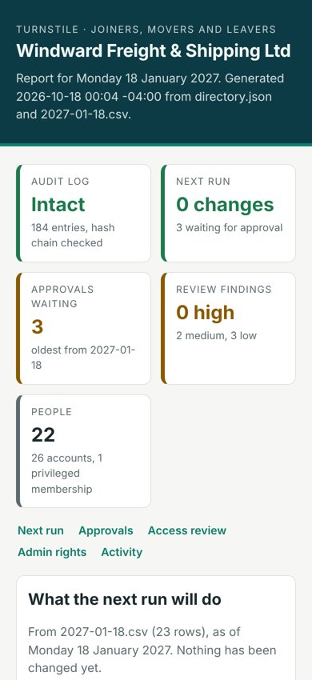

# Turnstile

[](https://github.com/Jody2905/turnstile/actions/workflows/ci.yml)

Joiners, movers and leavers, handled automatically. Turnstile reads the HR department's daily
export and keeps everyone's user account in step with it: new starters get an account with the
right access, people who change jobs get their new access and lose the old, and leavers are
switched off the morning after their last day. It's careful about it. It shows its plan first,
won't act on a broken export, gives out admin rights only with an approval that expires, and
records every change in an audit log that shows if anyone edits it.

> Windward Freight & Shipping Ltd, its staff and its directory are invented, for the demo.
> Kingstown and Bequia are real.

It runs on a practice directory out of the box, and on a real Active Directory domain through
a small connection file. Every push is linted and tested on Windows, Linux and macOS.



## Run it

Needs PowerShell 7.4 or newer (`winget install Microsoft.PowerShell`, then open **PowerShell 7**).

```powershell
pwsh .\demo.ps1                 # a week at the company, explained step by step

Install-Module Pester -Scope CurrentUser -Force -SkipPublisherCheck   # once
pwsh .\run-tests.ps1            # the tests
```

Using it directly:

```powershell
Import-Module .\Turnstile\Turnstile.psd1
Get-TurnstilePlan    -HrPath .\data\hr\2026-10-19.csv -DirectoryPath .\demo-output\directory.json | Show-TurnstilePlan
Invoke-TurnstileSync -HrPath .\data\hr\2026-10-19.csv -DirectoryPath .\demo-output\directory.json -WhatIf
Invoke-TurnstileSync -HrPath .\data\hr\2026-10-19.csv -DirectoryPath .\demo-output\directory.json | Show-TurnstilePlan
Test-TurnstileAuditLog -Path .\demo-output\audit.log

# Approvals
Get-TurnstileApproval   -DirectoryPath .\demo-output\directory.json -Status Pending
Approve-TurnstileAccess -DirectoryPath .\demo-output\directory.json -Id APR-0003 -ApprovedBy dwight.robertson -Ticket CHG-1042
Deny-TurnstileAccess    -DirectoryPath .\demo-output\directory.json -Id APR-0004 -DeniedBy garfield.providence -Reason "..."
Revoke-TurnstileAccess  -DirectoryPath .\demo-output\directory.json -Id APR-0003 -RevokedBy dwight.robertson -Reason "..."

# Access review
Get-TurnstileAccessReview -DirectoryPath .\demo-output\directory.json -HrPath .\data\hr\2026-10-23.csv | Show-TurnstileAccessReview
Get-TurnstileAccessReview -DirectoryPath .\demo-output\directory.json | Export-TurnstileAccessReview -Folder .\review

# The report
Export-TurnstileReport -DirectoryPath .\demo-output\directory.json -HrPath .\data\hr\2026-10-23.csv -Path .\report.html
```

`-WhatIf` and `-Confirm` work as they do for any PowerShell command. `-Today 2026-10-19` runs
it as if it were that day.

## What happens to whom

| Who | When | What Turnstile does |
|---|---|---|
| **New starter** | up to 7 days before their first day | creates the account **switched off**, with their job's groups, and a note with a temporary password for their manager |
| | on their first day | switches it on |
| **Changes job or office** | the day HR records it | adds the new job's groups, **removes the old job's**, updates title, department and manager, moves the account to the right office's OU |
| **Changes name** | the day HR records it | updates the display name and surname; the username stays the same, so nothing breaks |
| **Contractor** | as for a new starter | also adds them to Contractors and sets the account to expire on their end date |
| **Leaver** | on their last day | nothing: they can work their last day (the account is already set to expire at the end of it) |
| | the morning after | **switches the account off first**, then removes every group, notes why, and moves it to the Disabled OU |
| | 30 days later | deletes it, even if HR has dropped them from the export by then |
| **Rehired** | their new first day | the same account comes back, with the new job's access |

Usernames are `first.last`: letters only, accents removed, at most 20 characters (the Active
Directory limit). Zoë Ollivierre is `zoe.ollivierre`, Shanice O'Garro is `shanice.ogarro`, and
a second Kevin Browne is `kevin.browne2`.

## Who gets what: the policy

[`config/policy.json`](config/policy.json) is the single place access is decided:

- **Everyone** gets All Staff, plus their office's group (Kingstown Office or Bequia Office).
- **Each department** has its groups: Finance gets Finance and Finance Share, and so on.
- **Job titles** add more: anyone whose title includes Manager, Director or Supervisor gets
  People Managers; IT Support titles get Helpdesk.
- **Privileged groups** (Domain Admins, Server Admins, Finance Approvers, Payroll) are **never
  added without an approval**. See [Approvals](#approvals-for-admin-rights).

Access a person was given by hand is treated two ways:
- A **policy group** their job doesn't give them is removed, because the policy decides who's in it.
- **Any other group** is left alone and flagged every run for someone to review, because
  Turnstile can't know why it was granted.

Accounts with no employee ID (Administrator, service accounts) are never touched.

## Safety

HR exports go wrong: a truncated file, a bad batch update. Turnstile assumes they will.

- **Plan first.** `Get-TurnstilePlan` and `-WhatIf` show exactly what would change and touch
  nothing. A test proves the directory file is byte-for-byte the same afterwards.
- **A bad row is rejected on its own**, with the line number and the reason (an unknown
  department, a date like 19/10/2026 that could be read two ways, a contractor with no end
  date, the same person twice). That person's account is left as it was, and the rest of the
  export still counts.
- **Missing isn't the same as leaving.** Someone missing from the export is flagged, not
  switched off. Only an end date from HR makes someone a leaver.
- **Stops on a broken export.** If more than 20% of current staff are missing from the export,
  or more than 10% of accounts (at least 3) would be switched off at once, nothing is changed
  and the refusal is logged. An administrator can override with `-Force -Reason "..."`, and the
  reason goes in the audit log.
- **Leavers lose access first.** Switching the account off is the first action, before group
  removal and the OU move.
- **One failure stays contained.** If a change fails for one person, that person's remaining
  changes are skipped and everyone else is still done.
- **Passwords are written once.** Each temporary password is random (16 characters, from a
  cryptographic generator) and must be changed at first sign-in. It's written only to the
  manager's note, never to the directory file or the audit log. A test checks both.

## Approvals for admin rights

When someone's job calls for a privileged group, Turnstile raises a request (APR-0003) instead
of adding it:

```
  andre.cupid (Andre Cupid, E1022)
      ? Add to Server Admins: privileged, so it needs approval first (request APR-0003 raised)
```

- **Who can decide:** the person's line manager, or the group's owner (set in the policy by
  employee ID). Never the person themselves, never a service account, never a disabled account.
- **What it needs:** a change ticket (CHG-1042), and a length: 90 days by default, at most 365.
- **Approved:** added on the next run. **Denied:** not added, and not asked again unless their
  job title changes. **Revoked:** removed on the next run.
- **Expired:** removed the day after it ends, and a new request is raised automatically. Admin
  rights are never permanent by accident.
- **Moved or left:** the approval ends and the access goes with it. A request nobody needs
  any more is cancelled.
- **Admin rights from before Turnstile:** kept, but a "confirm" request is raised. Approve it
  and nothing changes; deny it and the access is removed.

**Why editing approvals.json doesn't work.** The requests live in `approvals.json`, but an
approval only counts if the hash-chained audit log holds a matching ApprovalGranted entry:
same request, person, group and end date. Mark your own request "Approved", or stretch an
end date to 2030, and Turnstile ignores it and says so. If the audit log itself fails its
check, Turnstile won't run at all until someone finds out why.

## Access reviews

`Get-TurnstileAccessReview` lists every group membership with where it came from (their job,
an approval, granted by hand, a service account) and flags what needs a look:

| | |
|---|---|
| **High** | privileged access with no current approval; an approval the audit log doesn't back up; a leaver still in groups; an audit log that fails its check |
| **Medium** | access granted by hand; enabled staff missing from the HR export; requests waiting more than 3 days; service accounts in privileged groups; accounts switched off by hand but still in groups |
| **Low** | approvals and contracts ending within 14 days; accounts with no employee ID (who owns `svc-backup`?) |

`Export-TurnstileAccessReview` saves two CSV files: the findings, and one row per membership
grouped by manager with a blank **Decision** column for them to sign off. Any cell starting
with `=`, `+`, `-` or `@` gets a leading `'`, so a job title like `=HYPERLINK(...)` can't run as
a formula when the file is opened in Excel (CSV injection). The review changes nothing.

## The report

`Export-TurnstileReport` writes one HTML page that opens in any browser, on a phone, and
prints cleanly:

- **Status tiles:** is the audit log intact, how many changes the next run will make, approvals
  waiting, review findings
- **What the next run will do**, person by person, with any problems in the export
- **Approvals** waiting for a decision (and how long they've waited), and recent decisions
- **The access review** findings, and **who holds admin rights** and on what basis
- **Activity:** the latest audit entries, with a green "all entries checked" or a red
  "fails its check"

| Dark mode | On a phone |
|---|---|
|  |  |

**Safe to open and to email.** It's a single file: no scripts, nothing loaded from the internet,
and a Content-Security-Policy that forbids scripts outright. Every value from the directory, the
HR export and the audit log is HTML-encoded, so a job title of `<script>alert(1)</script>`
appears as text. A test plants that title (and an ``) and checks neither survives;
turning the encoding off makes it fail.

## On a real Active Directory domain

Any command's `-DirectoryPath` can point at a connection file instead of a practice directory
([example](config/active-directory.example.json)):

```json
{ "kind": "ActiveDirectory", "domain": "windwardfreight.example",
  "searchBase": "DC=windwardfreight,DC=example", "server": "dc01.windwardfreight.example" }
```

Turnstile reads one snapshot of the users and groups under `searchBase`, plans exactly as
it does for the practice directory, and turns each change into the matching cmdlet
(`New-ADUser`, `Set-ADUser`, `Disable-ADAccount`, `Move-ADObject`, `Add-ADGroupMember`...).
The audit log, approvals and new-starter notes live next to the connection file.

| Turnstile | Active Directory |
|---|---|
| username | `sAMAccountName`, and also the object's name, so two Kevin Brownes in one OU never clash |
| employee ID | `employeeID`; accounts without one are never touched |
| end date | `accountExpires`, set to the start of the day *after* the last working day, the way AD counts it |
| "Turnstile switched this off" | `extensionAttribute15 = turnstile:disabledOn=2026-10-20`, so an account a person disabled stays disabled |
| temporary password | a SecureString, with "must change at next sign-in" |

**Setting it up safely:**

1. Install the AD module (RSAT): `Add-WindowsCapability -Online -Name Rsat.ActiveDirectory.DS-LDS.Tools~~~~0.0.1.0`.
   Without it, Turnstile says exactly that.
2. Run it as its own service account, **not a Domain Admin**. Delegate only what it needs: on
   the Staff and Disabled OUs, create, delete and move user objects, reset passwords and write
   user properties; on each group in the policy, write members. Domain Admins is protected by
   AdminSDHolder and can't be delegated this way, so it's best left out of the policy's roles
   and managed by hand.
3. Look before you leap: `Get-TurnstilePlan ... | Show-TurnstilePlan`, then `-WhatIf`. A test
   proves `-WhatIf` calls nothing that changes AD.
4. Run it every morning:

   ```powershell
   $action = New-ScheduledTaskAction -Execute 'pwsh.exe' -Argument '-NoProfile -Command "Import-Module C:\Turnstile\Turnstile\Turnstile.psd1; Invoke-TurnstileSync -HrPath \\hr01\exports\staff.csv -DirectoryPath C:\Turnstile\ad.json; Export-TurnstileReport -DirectoryPath C:\Turnstile\ad.json -Path C:\Turnstile\report.html"'
   Register-ScheduledTask -TaskName Turnstile -Action $action -Trigger (New-ScheduledTaskTrigger -Daily -At 6am) -User 'WINDWARD\svc-turnstile' -Password (Read-Host 'Password')
   ```

**How it's tested without a domain.** `tests/fakes/ActiveDirectory` is a fake AD module with
the same cmdlets and parameters, holding a small domain in memory. It refuses what a real
domain controller refuses: a duplicate name in an OU, a missing OU, adding someone to a group
twice, a weak or plain-text password, moving an account by username instead of distinguished
name. The main test runs weeks of joiners, movers, leavers, an approval, a deletion and a
rehire through **both** the practice directory and "AD", and requires them to be identical
after every day. Six deliberate mistakes in the connector (the CN from the display name,
the expiry a day early, no leaver stamp, moving by username, no manager, the stamp left on
after re-enabling) each made it fail. A fake can't catch everything a real domain would, so
the first runs on a real domain should be in a lab, starting with `-WhatIf`.

## CI

Every push runs on GitHub Actions ([workflow](.github/workflows/ci.yml)):

- **Lint:** PSScriptAnalyzer over the module and scripts, every rule on, zero findings
  allowed. Where a rule is set aside in the code, the reason is written next to it.
- **Tests on Windows, Linux and macOS:** all Pester tests, with the results kept as an artifact.
- **Demo:** runs the demo week on Windows, checks its audit log, and keeps the HTML report and
  the access review CSVs as artifacts, so every run has a report you can download and open.

Turning the linter on found real problems: a variable named `$event` (reserved by PowerShell),
the temporary password passed around as plain text instead of a SecureString, and files with
accented characters missing the byte-order mark that Windows PowerShell 5.1 needs to read
them correctly.

## The audit log

One line per event: runs starting and finishing, every change (with old and new values), every
refusal and override, and every approval request and decision. Each line carries a SHA-256 hash of its own contents *and* of the line
before it, so the lines form a chain:

```
7d1e…  {"seq":138,"at":"2026-10-20T07:00:02.114-04:00","event":"Disable","target":"desmond.hazell","detail":"Left on 2026-10-19: disable the account",...,"prev":"a93c…"}
```

`Test-TurnstileAuditLog` re-checks the chain and names the first line that doesn't fit: an
edited entry, a deleted or reordered line, or junk added to the file. One limit: removing lines
from the *end* leaves a shorter chain that's still valid. A real deployment would also send each
line to a separate log server as it's written.

## The demo week

`pwsh .\demo.ps1` builds a practice directory in `demo-output\` and plays through a week of
HR exports from `data\hr\`:

| Day | What happens |
|---|---|
| Fri 16 Oct | Turnstile takes over the 19 existing staff |
| Mon 19 Oct | the plan first; then Zoë (starts next Monday) is created switched off; a second Kevin Browne becomes `kevin.browne2`; Tricia moves from Port Operations to Finance; Keisha changes her name; a row with a department that doesn't exist is rejected. Three requests are raised: Andre, a new systems administrator, needs Server Admins, and Lystra's and Ronald's admin rights from before need confirming |
| Mon 19 Oct, later | Andre tries to approve himself: refused. A help-desk colleague tries: refused. His manager approves, with a ticket. Lystra's and Ronald's access is confirmed, Ronald's for 60 days |
| Tue 20 Oct | Andre gets Server Admins; Desmond's last day was yesterday: switched off and stripped of access; a contractor starts; the rejected row, now fixed, goes through |
| Wed 21 Oct | the export arrives with 6 rows instead of 24: **stopped**, nothing changed |
| Thu 22 Oct | an HR glitch gives all of Port Operations an end date: **stopped** |
| Thu night | someone edits approvals.json to stretch Andre's approval to 2030: Turnstile ignores it and says why |
| Fri 23 Oct | a normal export; run it twice and the second run changes nothing; then the access review, exported for managers |
| Mon 26 Oct | Zoë's first day: her account is switched on |
| Fri 20 Nov | Desmond's 30 days are up: his account is deleted |
| Mon 18 Jan 2027 | three approvals have run out: the access is removed and new requests raised; the contractor's end date has passed, so her account is switched off |

Then it checks the audit log, edits a copy to blame the wrong person, and shows the check
catching it. Finally it writes `demo-output\report.html` (and a snapshot from the first
Friday, `report-2026-10-23.html`).

## Tests

102 Pester tests:

- **Every rule above**, one scenario at a time: joiners (including a manager and their new
  report joining the same day), movers, name changes, contractors, leavers, 30-day deletion,
  rehires, people who never started, hand-granted access, privileged groups, service accounts.
- **Every safety stop**, the override and its audit entry, `-WhatIf`, a second run finding
  nothing to do, and one failed change staying contained.
- **Approvals:** who may and may not decide, tickets and lengths, approve, deny, revoke,
  expire, confirm, cancel on leaving; an approval typed into the file by hand, a stretched end
  date and a tampered audit log are all caught.
- **The access review:** each kind of finding, where each membership came from, that it changes
  nothing, and that exported CSVs can't carry Excel formulas.
- **Active Directory:** the practice directory and a strict fake domain stay identical through
  weeks of changes; passwords, expiry dates, leaver stamps, moves, `-WhatIf`, and a missing
  AD module.
- **The report:** every section, a stopped run and a broken audit log shown plainly, HTML and
  script injection, the security policy, no outside requests, and that it changes nothing.
- **Accounts switched off by hand stay off.** Turnstile only switches back on what it switched
  off itself (a leaver, or a new starter). An account locked during a security incident isn't
  quietly re-enabled the next morning. (A test for the access review found this one.)
- **The audit log:** editing, deleting, reordering and adding lines are all caught.
- **Three random weeks.** A random company gets random changes every day for three weeks:
  people join, move, change name, leave and are rehired. After every run, every rule is
  checked across the whole directory (exactly the right groups, the right OU, switched on only
  between start and end date, no admin rights, unique usernames, an intact audit log), and a
  second run must find nothing to do.
- **The tests were checked too.** I broke twelve rules in the code on purpose, and each break
  made tests fail: movers keeping old access, leavers keeping groups, admin rights granted
  automatically, leavers switched off a day late, no OU moves, username clashes ignored,
  approvals not checked against the audit log, self-approval, approvals that never expire,
  anyone allowed to approve, a tampered audit log ignored, and hand-disabled accounts switched
  back on.

## How it's organised

```
Turnstile/
  Turnstile.psd1        module manifest
  Public/               the commands you run
    Sync.ps1            Get-TurnstilePlan, Invoke-TurnstileSync, the new-starter note
    Approvals.ps1       Get-TurnstileApproval, Approve-, Deny- and Revoke-TurnstileAccess
    Review.ps1          Get-, Show- and Export-TurnstileAccessReview
    Report.ps1          Export-TurnstileReport: the HTML page
    HrFeed.ps1          Import-TurnstileHrFeed: reading and checking the export
    Show.ps1            Show-TurnstilePlan
  Private/
    Planner.ps1         works out what should change (changes nothing itself)
    Policy.ps1          who gets which groups
    Directory.ps1       the practice directory; every change goes through one function,
                        so an Active Directory connector can slot in behind it
    ActiveDirectory.ps1 the AD connector: reading a snapshot, turning actions into AD cmdlets
    Approvals.ps1       request states, who may decide, checking approvals against the audit log
    Audit.ps1           the hash-chained audit log and Test-TurnstileAuditLog
    Common.ps1          usernames, passwords, dates, hashing
config/policy.json      the access policy
config/active-directory.example.json   a connection file for a real domain
data/hr/                the demo week's HR exports
tests/                  Pester tests, and fakes/ActiveDirectory (the fake domain)
.github/workflows/      CI: lint, tests on three systems, the demo and its report
demo.ps1, run-tests.ps1, PSScriptAnalyzerSettings.psd1
```

## Built with

PowerShell 7, Pester 5, PSScriptAnalyzer, GitHub Actions. The Active Directory connector uses
the ActiveDirectory module (RSAT). No other dependencies.
